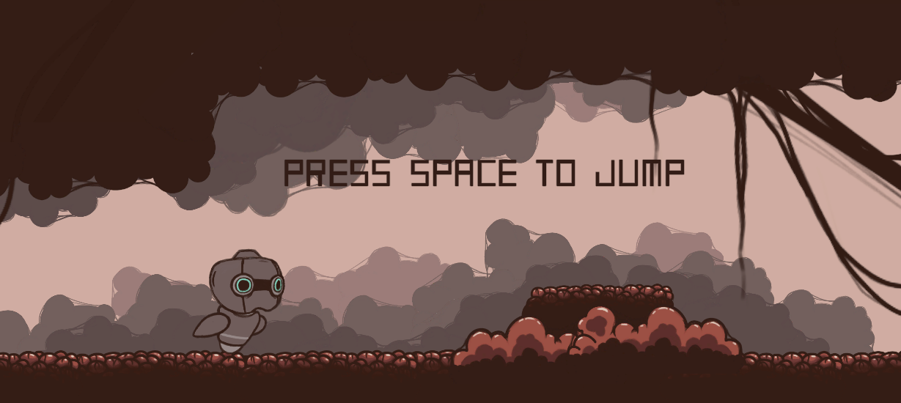
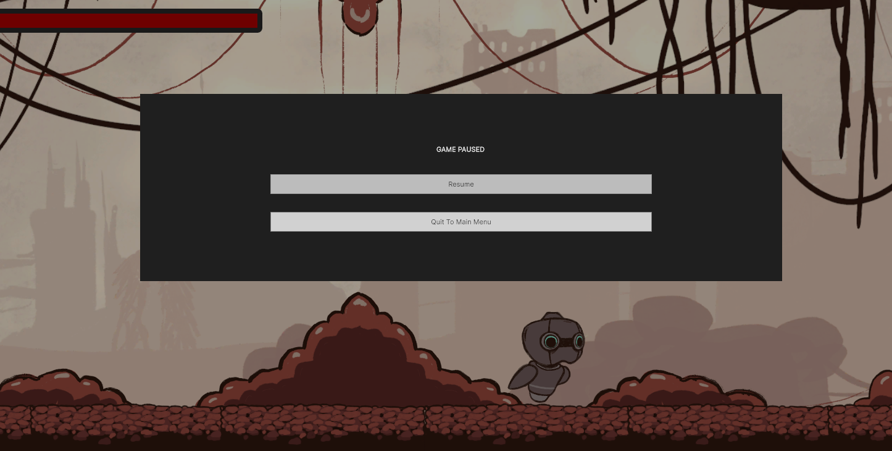
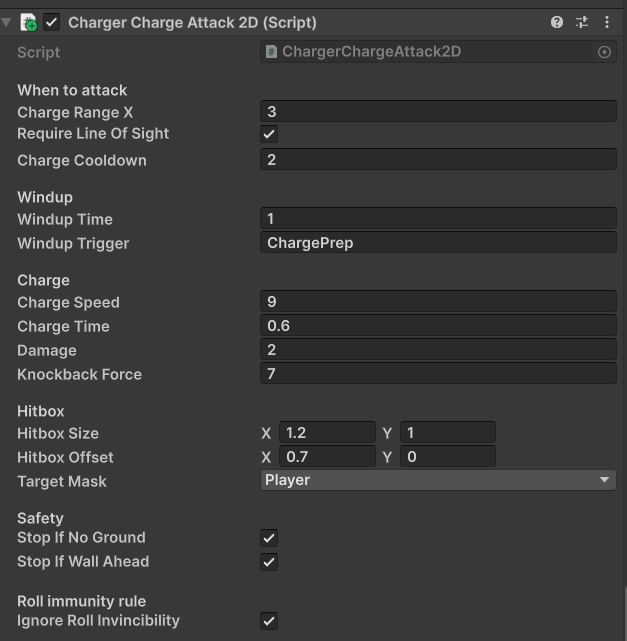

# The Last Human

**Akční 2D plošinovka v Unity: robot přenáší rostlinu nakaženým světem do laboratoře.**

[Obrazový průchod](docs/demo.md) · [Můj podíl a tým](docs/credits-and-evidence.md) · [English](README.md) · [Všechny projekty](https://github.com/Dolik64)

*Skutečný vývojový screenshot z týmového reportu z prosince 2025.*

## O hře

The Last Human vznikl ve tříčlenném týmu v předmětu **HRY na FEL ČVUT**. Robot se snaží dopravit rostlinu do laboratoře a pomoci vyléčit nakažený svět. Hra propojuje souboje, překonávání překážek, odemykání schopností a průchod navazujícími místnostmi.

Prohlédnutý Unity projekt obsahuje více typů nepřátel, vícefázového bosse, checkpointy, ukládání stavu, přechody mezi scénami a menu.

## Můj podíl

Jsem **Jiří Doležal** a zaměřoval jsem se především na chování nepřátel a soubojové mechanismy. Týmové reporty mi výslovně připisují **AI nepřátel, prefaby, vizualizaci útoků a souboje hráče**. V historii commitů je doložená také práce na:

- hlídkování a pronásledování, detekci hráče a hran plošin, časování útoků a hitboxech;
- chování bosse, stavech Animatoru, změnách fází podle zdraví a střelbě projektilů;
- vizualizaci zásahů, ladění odhození, kolizí a napojení zdraví nepřátel;
- osazování úrovní, 2D osvětlení a svícení podle aktuálního spritu nepřítele;
- propojení s Input Systemem, opravách ovládání gamepadem a obsluze pauzy.

Jde o můj příspěvek do týmové hry. Grafiku, návrh úrovní a další systémy vytvářeli také spoluautoři; rozdělení práce uvádí [kredity a přehled podkladů](docs/credits-and-evidence.md).

## Galerie

| Hlavní menu | Pauza ve hře |
| --- | --- |
|  |  |

| Nastavení útoku nepřítele | Ladění hitboxů |
| --- | --- |
|  |  |

Záběry pocházejí z týmových reportů z **listopadu a prosince 2025**. Zachycují tehdejší rozpracovanou verzi a editorové nástroje. Nejde o nové ověření finálního vydání.

## Technologie

**C# · Unity 6 · Physics2D · stavové automaty Animatoru · URP 2D · Unity Input System · Cinemachine · Timeline · Git / Git LFS**

Prohlédnutý projekt používá editor **6000.2.6f2**. Další obrázek úrovně a vysvětlení soubojových systémů obsahuje [obrazový průchod](docs/demo.md).

Repozitář obsahuje dokumentaci a šest existujících vývojových záběrů. Zdrojový Unity projekt ani spustitelný build zde nejsou; týmový projekt zůstává v původním univerzitním GitLabu.
