# The Last Human

**A Unity 2D action platformer about a robot carrying a plant through an infected world.**

[Visual walkthrough](docs/demo.md) · [My contribution & team credits](docs/credits-and-evidence.md) · [Česky](README.cs.md) · [All projects](https://github.com/Dolik64)

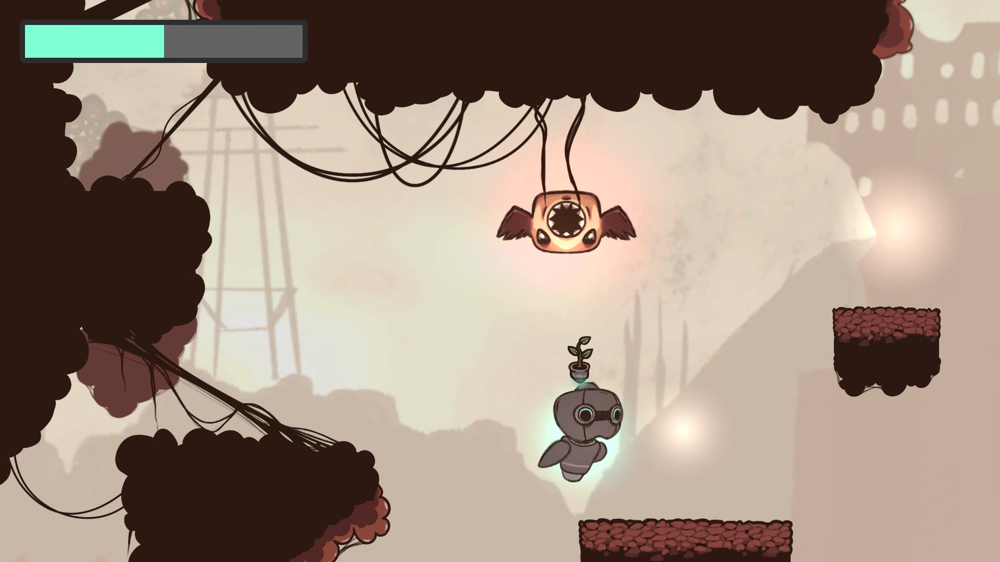

*Gameplay screenshot supplied by Jiří Doležal, added on 17 November 2026.*

## The game

The Last Human was developed by a three-person team for the **HRY game-development course at CTU FEL**. A small robot must get a plant to a laboratory in an attempt to cure an infected world. Combat, platforming and unlockable abilities shape the journey through connected rooms.

The reviewed Unity project includes enemy variants, a multi-phase boss, checkpoints, saved state, scene transitions and menus. This repository presents the project and my work within the team.

## My contribution

I am **Jiří Doležal**. My main focus was enemy behaviour and combat implementation. The progress reports explicitly credit me with **enemy AI, prefabs, attack visualisation and player combat**. The inspected Git history also records work on:

- **Enemy behaviour:** patrol/chase transitions, player sensing, ground and edge checks, attack timing, hitboxes and configurable enemy prefabs.
- **Boss combat:** Animator-driven attack states, health-based phase changes, projectile attacks and encounter debugging.
- **Combat feedback and tuning:** hit visualisation, knockback adjustments, collision fixes and enemy health integration.
- **Scene integration:** placing enemies and platforms, 2D lighting setup and sprite-based enemy glow.
- **Input and UI integration:** Input System action mapping, gamepad connection fixes and pause-menu handling.

These are contributions to a shared project. [Team credits and the evidence behind this summary](docs/credits-and-evidence.md) distinguish my work from the other team members' work.

## Live gameplay captures

Six screenshots taken on **17 November 2026** from the running standalone game and Unity Play mode. The tutorial and checkpoint images are cropped to the Game view; the other four retain the captured frame. No scene was generated or retouched.

| Robot & plant | Jump |
| --- | --- |
| 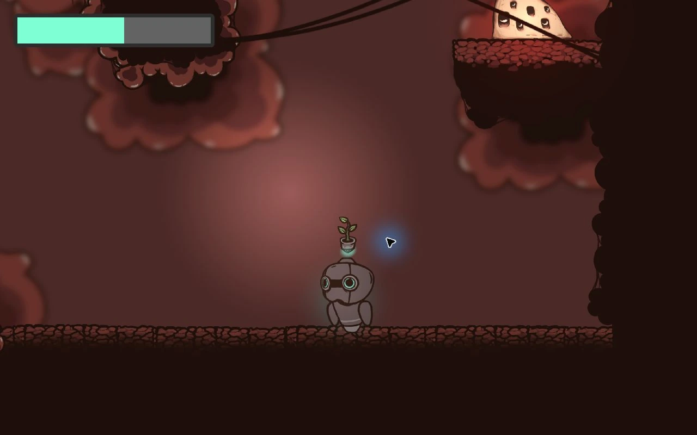 | 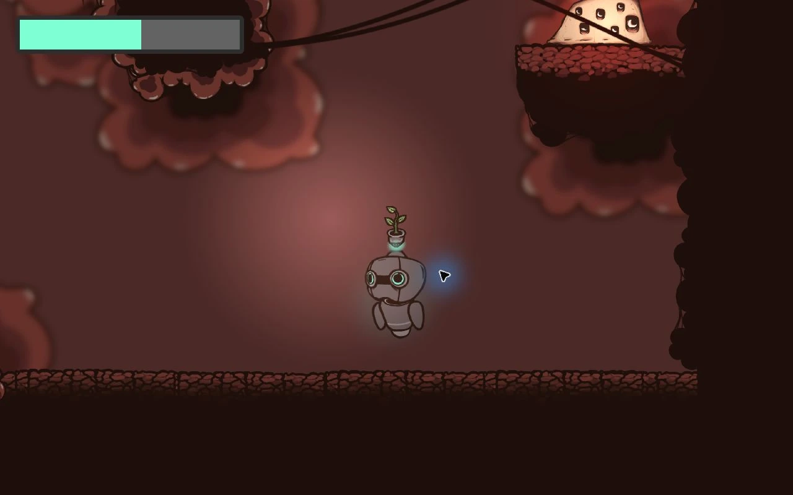 |

| Melee attack | Pause menu |
| --- | --- |
| 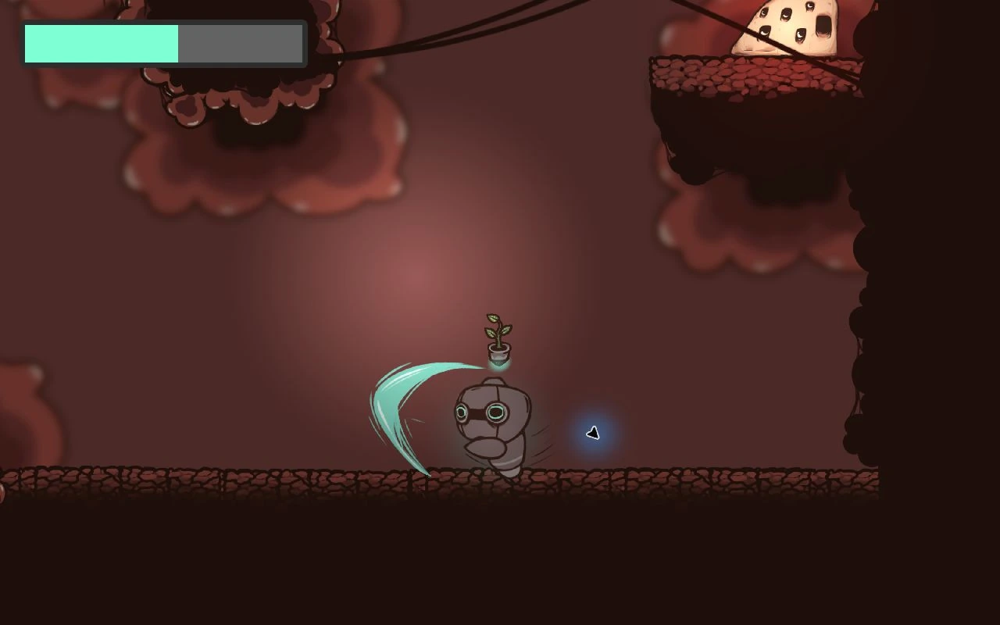 | 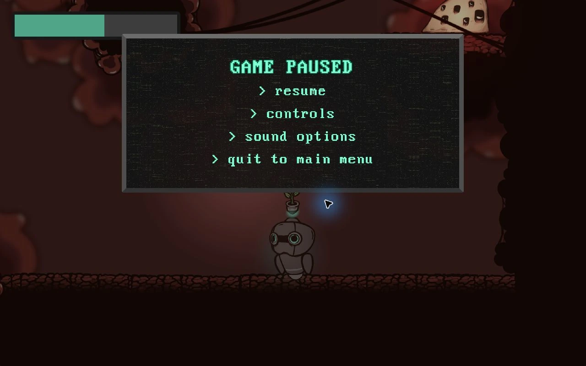 |

| Tutorial | Recharge checkpoint |
| --- | --- |
| 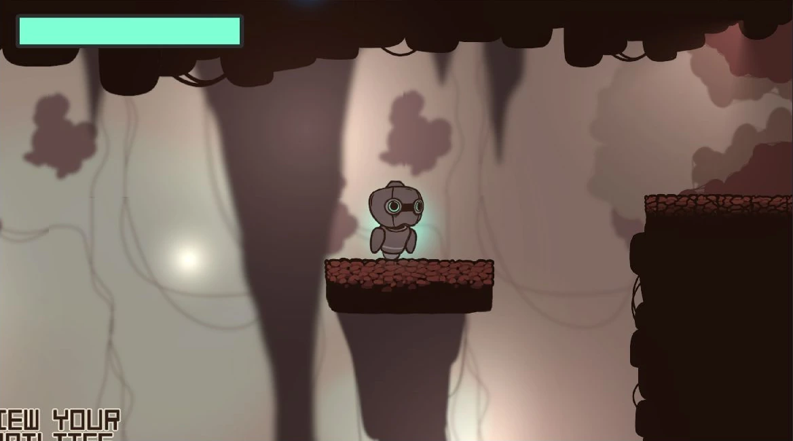 | 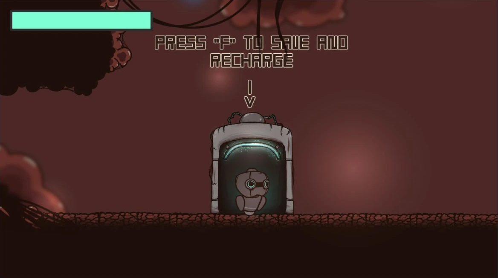 |

[View the six captures at full size](docs/gameplay-gallery.md).

## Interface & implementation gallery

| Main menu | Pause menu |
| --- | --- |
| 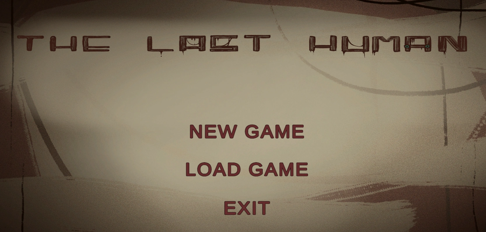 | 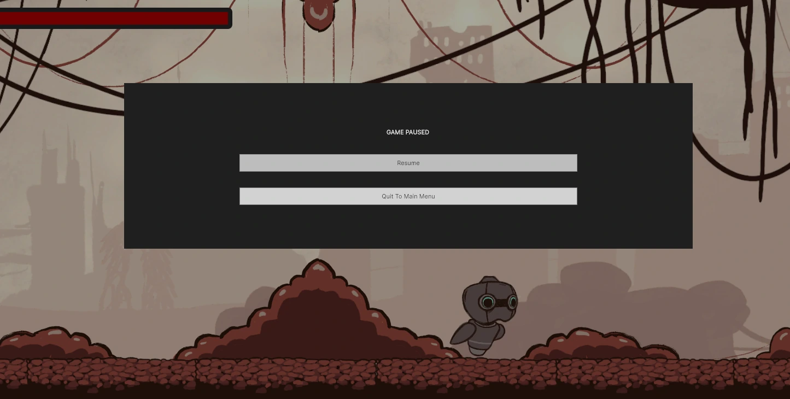 |

| Configurable enemy attacks | Hitbox debugging |
| --- | --- |
| 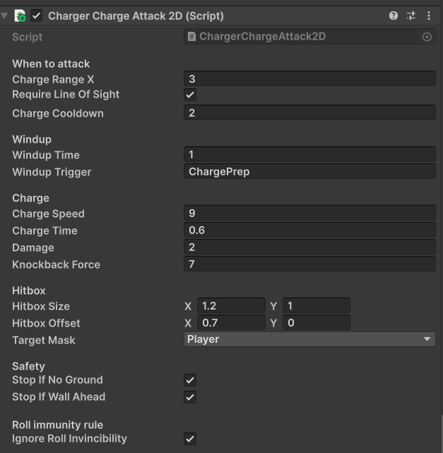 | 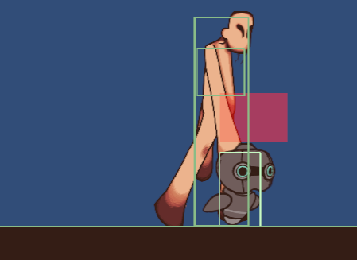 |

The gallery images above come from the team's **November and December 2025 progress reports**. They show a development build and editor tools; they are not captures of a newly tested final release. The walkthrough includes a wider scene view and explains how the systems fit together.

## Technical focus

**C# · Unity 6 · Physics2D · Animator state machines · URP 2D · Unity Input System · Cinemachine · Timeline · Git / Git LFS**

The reviewed editor version is **Unity 6000.2.6f2**. The package manifest includes URP 17.2.0, Input System 1.14.2, Cinemachine 3.1.4 and Timeline 1.8.9.

## Explore

- [Visual walkthrough](docs/demo.md): tutorial, enemy tuning, scene integration and boss behaviour.
- [Credits & evidence](docs/credits-and-evidence.md): authorship, screenshot provenance and the scope of this presentation.

This is a presentation repository containing documentation, a supplied lead screenshot, six new runtime captures and six earlier development captures. It does not distribute the Unity source project or a playable build. The team project remains in its original university GitLab repository.
