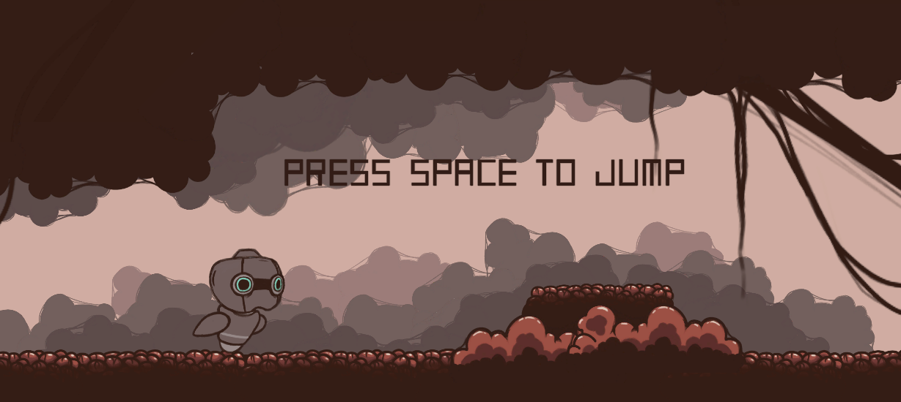
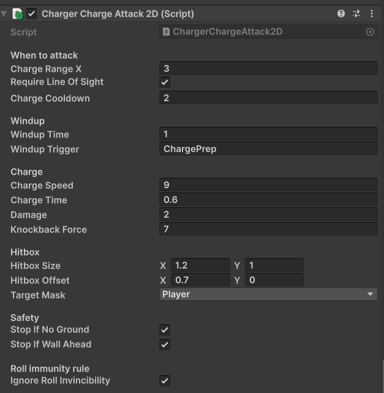
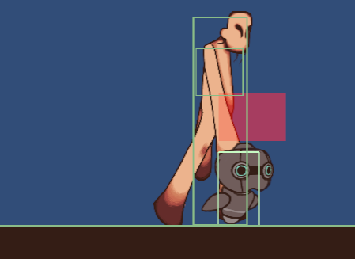
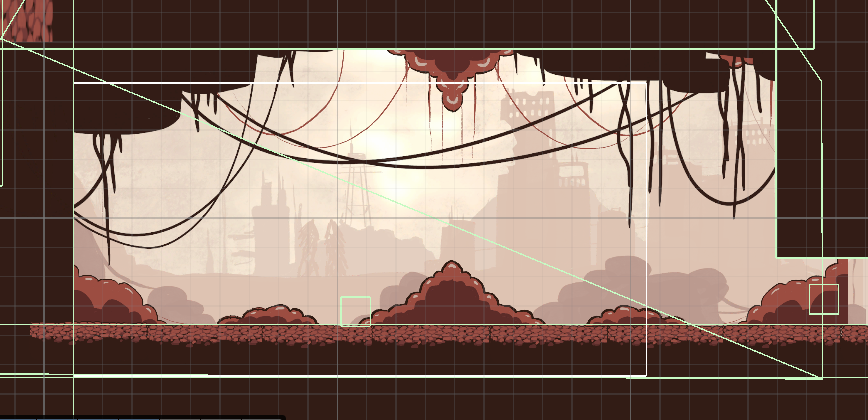
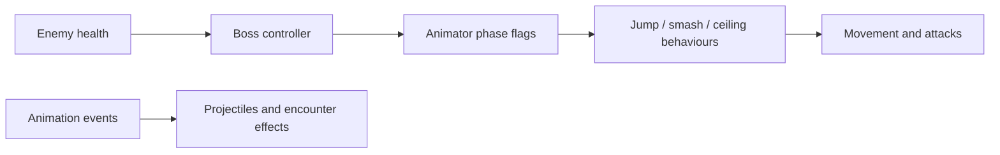
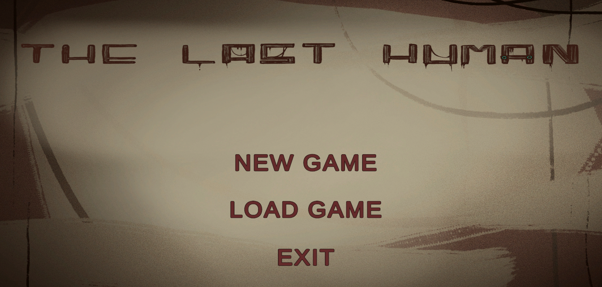
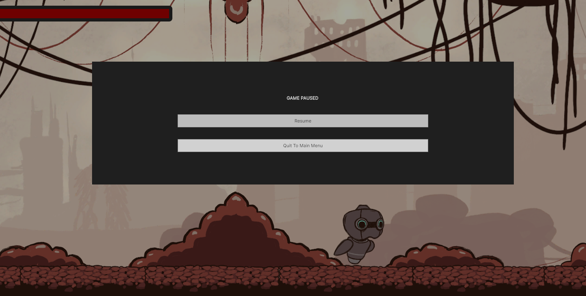

# Visual walkthrough

[Project](../README.md) · [Česky](../README.cs.md) · [Credits & evidence](credits-and-evidence.md)

## 1. Introduce the movement in context

The tutorial introduces jumping inside the game's layered environment. The project then extends movement and combat with unlockable abilities. The screenshot is from Report 2, dated 2 December 2025; it demonstrates the tutorial presentation at that stage.

## 2. Build readable enemy encounters

| Tune behaviour in the Inspector | Inspect the attack area |
| --- | --- |
|  |  |

Enemy scripts expose detection distance, attack range, wind-up, recovery, cooldown, damage and knockback as editable parameters. The LongArms implementation includes idle, patrol, chase, return-to-spawn and attack states, with ground and wall sensing. This makes it possible to tune encounters through prefabs and scene placement.

The Inspector capture shows a charger's settings. The adjacent capture is an editor/debug view with collision and attack geometry, not an unobstructed gameplay screenshot. Jiří's progress-report credit covers enemy AI, prefabs and attack visualisation.

## 3. Integrate the encounters into rooms

The first-room capture shows scene composition in the editor. Subsequent Git history records Jiří's changes to enemy and platform placement, 2D lighting and enemy glow. The broader project connects rooms with scene transitions, checkpoints and saved state; these shared systems should not all be attributed to one contributor.

## 4. Coordinate a boss through animation states

The inspected boss implementation uses Animator state behaviours to coordinate jump and smash attacks, a ceiling phase and health-based transitions. The controller sets phase flags at configured health thresholds; attack behaviours drive movement and animation events trigger effects such as projectiles.

This is a diagram summarising the inspected implementation. It is not a screenshot or a claim that a fresh full boss fight has been play-tested for this showcase.

## 5. Keep the game flow connected

The reports document menus connected to game-state management. Later commits by Jiří cover new input action integration, gamepad fixes and pause-menu handling. UI, artwork, core management and save/load are shared team work with separate credits.

## Presentation scope

The six images in this walkthrough were extracted from existing team reports. The project README additionally features a gameplay screenshot supplied by Jiří Doležal on 17 November 2026. No AI-generated scene, reconstructed gameplay or placeholder screenshot is used. These images do not represent a verified full playthrough. For screenshot dates, attribution and evidence, see [credits & evidence](credits-and-evidence.md).
