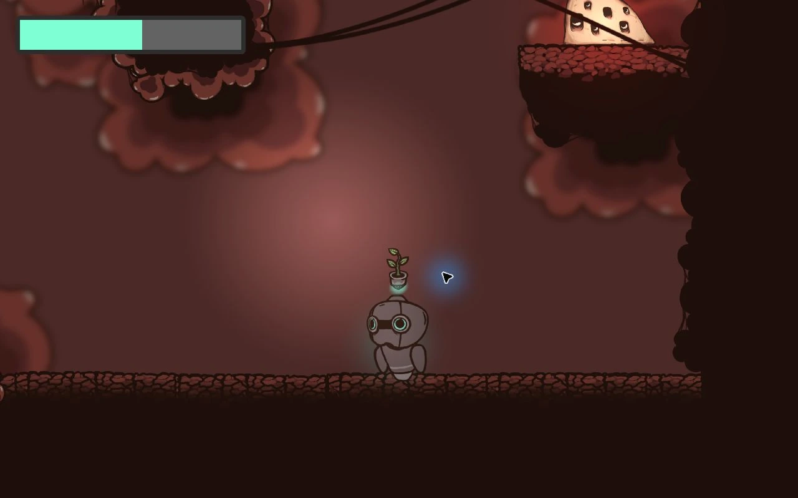
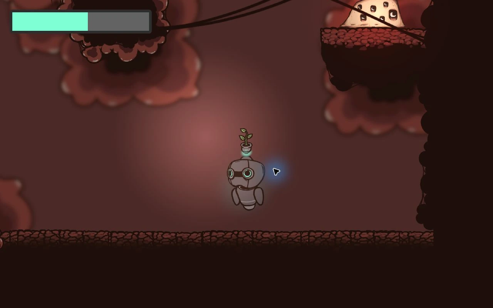
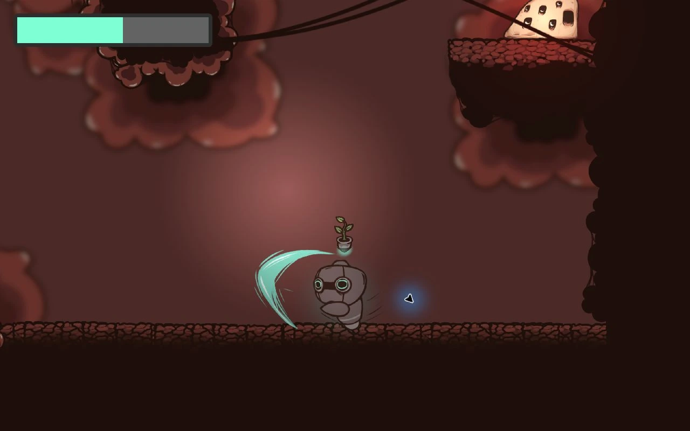
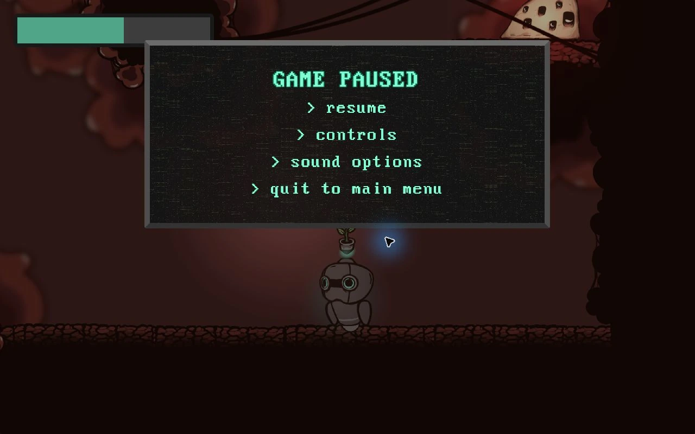
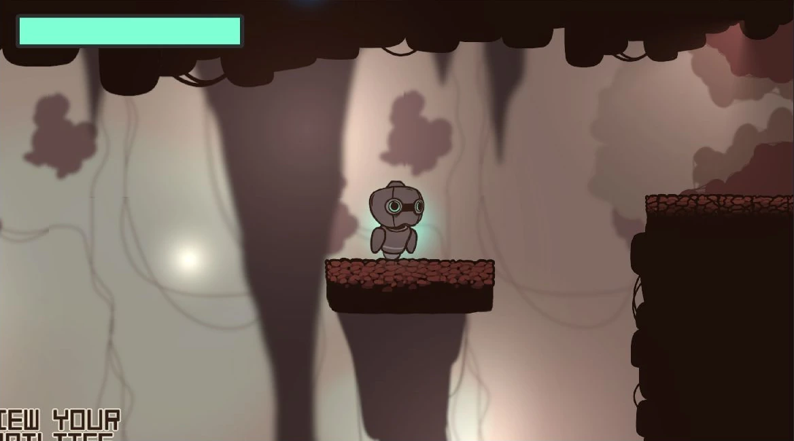
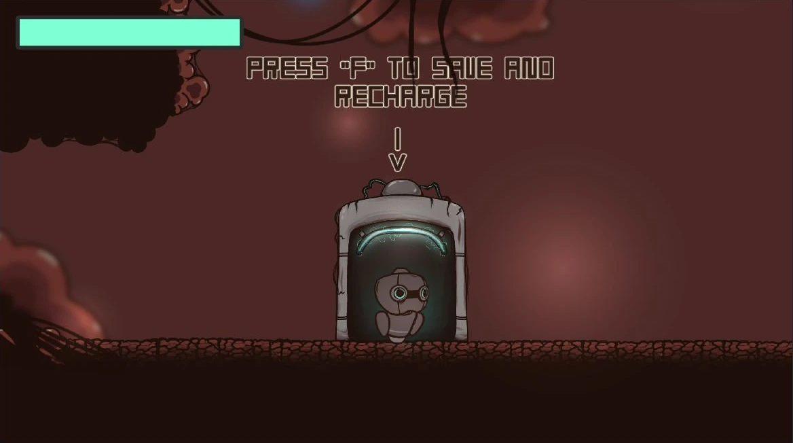

# Live gameplay gallery

[Project](../README.md) · [Česky](../README.cs.md) · [Credits & evidence](credits-and-evidence.md)

Captured on **17 November 2026** from the running standalone game and from the original project in **Unity 6000.2.6f2 Play mode**. These are selected runtime frames, not a full-playthrough verification or performance benchmark.

## 1. Robot carrying the plant

Standalone game: the robot, plant, HUD and layered cavern environment.

## 2. Jump

Standalone game: a captured frame of the jump animation.

## 3. Melee attack

Standalone game: the visible melee attack effect. This frame demonstrates the attack presentation, not a completed enemy encounter.

## 4. Pause menu

Standalone game: the pause interface displayed over the game world.

## 5. Tutorial

`TutorialScene` running in Unity Play mode. The capture is cropped to the Game view to remove the surrounding editor interface.

## 6. Recharge checkpoint

`Level_1_Scene` running in Unity Play mode. The capture is cropped to the Game view.

## Capture handling

The capture tool supplied JPEG frames. Publication copies use compressed WebP at the same dimensions as the prepared captures. The two Unity captures were cropped using the recorded Game-view rectangles. The original JPEG captures and PNG intermediates are retained locally; compression does not add or retouch scene content. [Image provenance](../assets/provenance.json) records capture times, processing and file hashes without including local filesystem paths.
